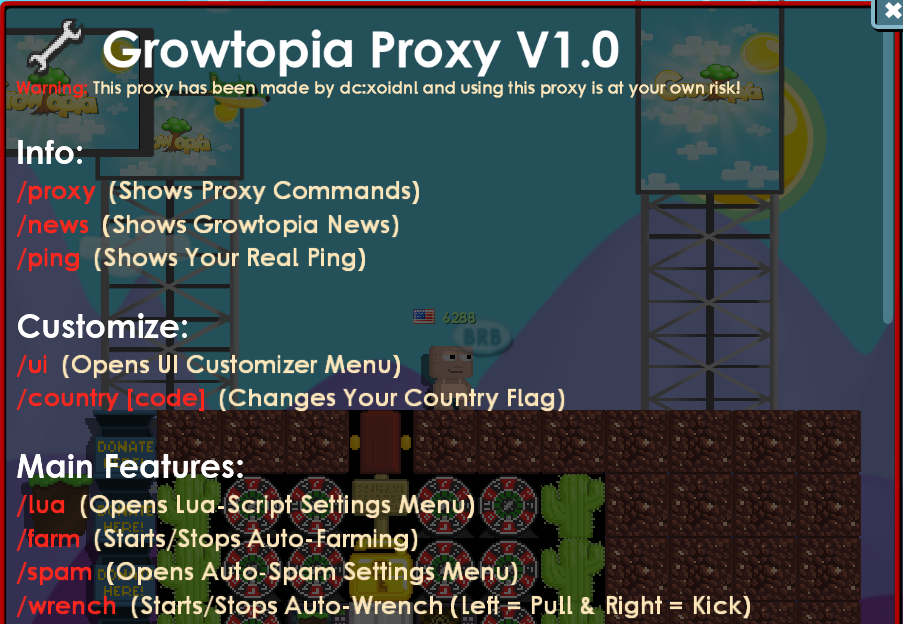
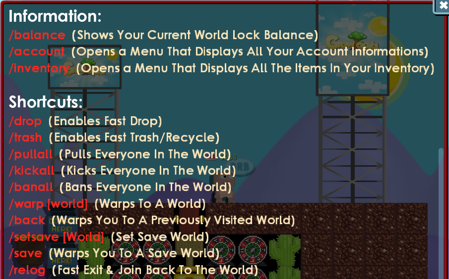
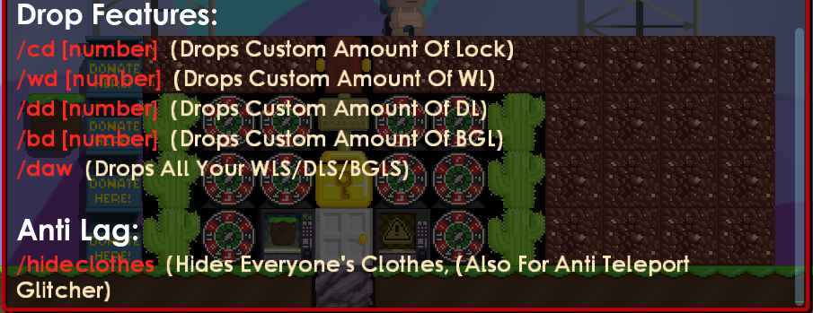
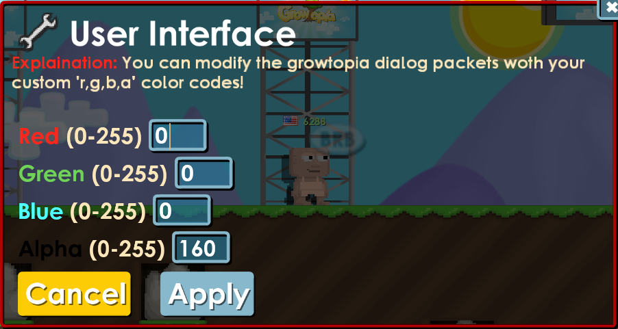
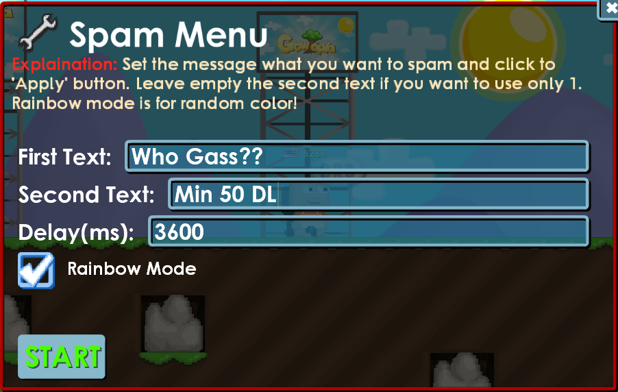

# AdmaProxy

by Unicornlite (https://github.com/unicornlite)

Based on GrowtopiaProxy by batutekoz77.

AdmaProxy is a bridge proxy for Growtopia on Windows. It sits between the game
client and the server, so it can inspect, modify, and inject packets in real
time. Everything is controlled from inside the game with slash commands: type
`/proxy` to open the command menu.

## How it works

- The proxy runs on the same PC as the game. On start it redirects the
  client's connection to itself (via the hosts file, restored automatically
  when the proxy exits), fetches the real server address, and forwards traffic
  both ways: client to proxy to server, and server to proxy to client.
- A built-in HTTP server handles the server-address lookup, and the game
  traffic itself runs over ENet.
- It needs administrator rights (it relaunches itself as admin on start) and
  it closes Growtopia first if the game is already running, so start the proxy
  before launching the game.
- Packet logging is built in. What gets logged is tuned in
  `Source/Main/Config.hpp` (`ShouldLogNetMessage`, `BASIC_LOGS`).

## Commands

### Info

- `/proxy` - Opens the command menu.
- `/ping` - Shows your client and server ping.

### Customize

- `/ui` - Opens the UI customizer menu.
- `/country <code>` - Changes your country flag.

### Main features

- `/farm` - Starts/stops auto farming.
- `/spam` - Opens the spam settings menu.
- `/wrench` - Toggles auto wrench (left click pulls, right click kicks).
- `/antimod` - Auto-leaves the world the moment a moderator enters
  (mstate/smstate detection in OnSpawn).
- `/antigravitasi` - Floats in place at the current height instead of falling.
  Alias: `/antigravity`.

### World tools

- `/collect` - Automatically walks to nearby dropped items and picks them up.
  Nearest drop first. With `/antigravitasi` on, only X moves.
- `/zoom` - Unlimited zoom (client-side only, via local OnSpawn mstate).
  Turning it off restores normal zoom.
- `/copyworld` - Saves the current world layout (foreground/background per
  tile) to `world_<NAME>.txt` in the proxy folder.
- `/pasteworld [name]` - Rebuilds a saved world layout here, placing blocks
  from your inventory one by one. Without a name it pastes the last copied
  world. Run again to stop.
- `/copymusic` - Saves the world song (all sheet-music background tiles:
  position is time/pitch, item is the instrument) to `song_<NAME>.txt`.
- `/pastemusic [name]` - Rebuilds a saved song here. Same rules as
  `/pasteworld`.
- `/tp <x> <y>` - Teleports to tile coordinates.
- `/tp <player>` - Teleports to a player's last known position.
- `/tp` - Teleports to the point saved with `/tpset`.
- `/tpset` - Saves the current position as the teleport point.
- `/doormark` - Shows open doors as green blocks and closed doors as red
  blocks. Takes effect on the next world join; turning it off restores the
  view right away.

### Information

- `/balance` - Shows your current lock balance.
- `/account` - Opens the account information menu.
- `/inventory` - Opens the inventory menu.

### Shortcuts

- `/drop` - Toggles fast drop.
- `/trash` - Toggles fast trash.
- `/pullall` - Pulls everyone in the world.
- `/kickall` - Kicks everyone in the world.
- `/banall` - Bans everyone in the world.
- `/warp <name>` - Warps to a world.
- `/back` - Warps to the last world.
- `/setsave <name>` - Sets the save world.
- `/save` - Warps to the save world.
- `/relog` - Leaves and rejoins the same world.
- `/change` - Toggles fast BGL change.

### Drop

- `/cd <amount>` - Drops that many locks.
- `/wd <amount>` - Drops that many World Locks.
- `/dd <amount>` - Drops that many Diamond Locks.
- `/bd <amount>` - Drops that many Blue Gem Locks.
- `/daw` - Drops all your locks.

### Anti lag

- `/hideclothes` - Hides everyone's clothes and removes their effects.

### Built-in extras

- Roulette verifier: tags real server roulette results in chat.
- Custom dialog colors.
- Fast forwarding: packets are relayed without added delay.

## World tools notes

- **Teleport hotkey:** hold **F8** and punch a tile with your fist to teleport
  to it. The punch packet is dropped, so the block is not hit. Change the key
  in `Source/Main/Config.hpp` (`Main.TELEPORT_HOTKEY`, a Windows virtual-key
  code, `0x77` = F8).
- **Teleport, auto-collect, and paste need in-game testing:** they assume the
  server accepts the proxy's position and placement packets the same way a
  private server (Gurotopia) does. If the server rubber-bands or rejects them,
  the feature will visibly fail rather than silently misbehave.
- **Copy world is foreground/background only (v1):** locks, signs, doors, and
  other tile extras are not copied. The file format is plain text: a header
  line, the world size, then one `x y fg bg` line per non-empty tile.
- **Copy music copies sheet music, not note blocks:** the world song is the
  sheet-music layout (X = time, Y = pitch, item = instrument). The Note Block
  item (220) plays one fixed song and has no pitch, so it is not part of the
  song.
- **Door marker** replaces door tiles with solid green (open) and red (closed)
  blocks on your screen only. It applies when a world loads; turning it off
  resends the original map to restore the view.
- **Unlimited zoom** only changes what your client renders. The server still
  treats you as a normal player.
- **Map parsing limits:** the proxy parses the world tile map and drop list
  from the map packet. Tiles with an unknown extra-data type stop the parse
  with a warning in the proxy log; features using the map then work on partial
  data until you rejoin.

## Screenshots








## Building

### Requirements

- Windows 10/11
- Visual Studio 2026 Community with the C++ workload
- Git
- vcpkg (only for OpenSSL; `enet.lib` is bundled in this repo)

### Steps

1. Clone this repo:
   ```
   git clone https://github.com/unicornlite/AdmaProxy.git
   ```
2. Set up vcpkg and install OpenSSL:
   ```
   git clone https://github.com/microsoft/vcpkg.git
   cd vcpkg
   .bootstrap-vcpkg.bat
   .vcpkg install openssl:x64-windows
   .vcpkg integrate install
   ```
3. Open `GrowtopiaProxy.slnx` in Visual Studio.
4. Make sure vcpkg is enabled for the project (Project -> Properties ->
   vcpkg -> Use Vcpkg: Yes).
5. Build the `x64/Release` configuration (`Ctrl + Shift + B`).
6. Run `x64/Release/Source.exe`. It asks for administrator rights on start.

The project targets C++23 (`/std:c++23preview`) and C17 (`/std:c17`).

## Configuration

All settings live in `Source/Main/Config.hpp`:

- `Main.NAME` / `Main.VERSION` - proxy name and version shown in-game.
- `Main.TELEPORT_HOTKEY` - teleport hotkey, a Windows virtual-key code
  (`0x77` = F8). Hold it and punch a tile with your fist to teleport there.
- `Local` - address the proxy listens on (`127.0.0.1`, TCP 443, UDP 17123).
- `Server` - leave `IP` empty and `UDP` at -1 to use the real Growtopia
  server (address fetched automatically).
- `Client` - client version and protocol the proxy reports (5.61 / 225).
- `ShouldLogNetMessage` - which packet types get logged.

## Running

1. Start `Source.exe` (admin). It closes Growtopia first if the game is
   already running.
2. Launch Growtopia and log in as usual. Traffic now goes through the proxy.
3. Type `/proxy` in game to open the command menu.
4. Close the proxy when done; it restores the hosts file automatically.

## Notes and limits

- Teleport, auto-collect, and paste assume the server accepts the proxy's
  position and placement packets the same way a private server does. If the
  server rubber-bands or rejects them, the feature visibly fails instead of
  silently misbehaving. In-game testing is needed.
- Unlimited zoom and door marker only change what your client renders.
- Use at your own risk: proxies and modified clients can be detected by the
  game operator. No ban-safety claim is made here.

## Credits

- Unicornlite - author and maintainer
- ENet - low-latency networking library
- OpenSSL - HTTPS handling in the built-in HTTP server
- vcpkg - dependency management

## License

This project is licensed under the MIT License - see the LICENSE file for
details.
